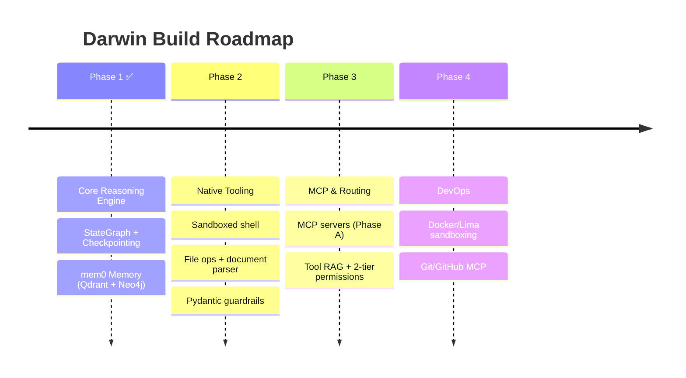

# Darwin

> An autonomous, general-purpose agentic execution engine — inspired by Claude Code and Hermes Agent.

Darwin autonomously reasons, navigates file systems, executes code in sandboxed environments, interfaces with external platforms via standard protocols (MCP), and self-corrects across complex workflows.

---

## What Darwin Does

- **Autonomous reasoning loop** — a LangGraph `StateGraph` tool-calling engine that plans first and executes second.
- **Model-agnostic** — works with any OpenAI-compatible provider (OpenAI, DeepSeek, local vLLM/Llama, Ollama) via configurable Base URL + API Key + Model Name.
- **Durable sessions** — PostgreSQL checkpointing means conversations survive process restarts.
- **Layered memory** — short-term conversational buffer, long-term vector (episodic) memory, and long-term structured knowledge graph.
- **Hybrid background work** — Redis/Valkey + RQ offloads non-blocking pipeline jobs from the reasoning loop.

## Core Features

| Feature | Stack |
|---|---|
| Reasoning engine | LangGraph StateGraph (tool-calling loop) |
| Persistence | PostgreSQL (PostgresSaver) |
| Queues | Redis/Valkey + RQ |
| Vector memory | Qdrant (via mem0) |
| Graph memory | Neo4j (via mem0) |
| Embeddings | sentence-transformers/all-MiniLM-L6-v2 (local, via mem0) |
| Validation | Pydantic structured outputs |
| Guardrails | Deterministic prompt clamp + command gating |

## MCP Shoutout

Darwin stands on the shoulders of the Model Context Protocol ecosystem:

- **@modelcontextprotocol** — filesystem, sequential-thinking, fetch, puppeteer
- **mcp-server-docker** — container lifecycles and sandboxing
- **mcp-server-git / @github/mcp-server** — local + remote Git operations
- **context7-mcp** — versioned library documentation on demand
- **firecrawl-mcp / exa-mcp-server** — neural web search and markdown scraping
- **notion-mcp / @modelcontextprotocol/server-slack** — workspace integrations
- **mcp-server-time / server-postgres / server-sqlite** — time and DB utilities

## Architecture & Flow

```mermaid
%%{init: {
  'theme': 'base',
  'themeVariables': {
    'fontFamily': 'Inter, Segoe UI, sans-serif'
  }
}}%%
flowchart TD
    YOU(["👤 You"]):::user
    CHAT["💻 CLI Chat Loop<br/>(main.py)"]:::entry
    AGENT["🧠 StateGraph Agent<br/>Reasoning Loop"]:::agent
    TOOLS["🔧 Tools / MCP<br/>(Phase 2+)"]:::tools
    MEMOS["mem0<br/>Memory Client"]:::tx
    VECTOR[("🗄️ Qdrant<br/>Vector Store")]:::vector
    GRAPH[("🕸️ Neo4j<br/>Graph Store")]:::graph
    PG[("💾 Postgres<br/>Checkpointer")]:::postgres
    QUEUE[("⚡ Valkey<br/>+ RQ Workers")]:::queue
    PROXY["🤖 LLM Provider<br/>(OpenAI / DeepSeek / vLLM)"]:::proxy

    YOU -->|prompt| CHAT
    CHAT -->|each turn| AGENT
    AGENT -->|tool_calls| TOOLS
    TOOLS -->|results| AGENT
    AGENT <-->|prompt / reply| PROXY
    AGENT <-->|checkpoint| PG
    AGENT <-->|recall / sync| MEMOS
    QUEUE -- background jobs --> AGENT
    MEMOS -->|vectors| VECTOR
    MEMOS -->|entities + relations| GRAPH

    linkStyle 0 stroke:#e74c3c,stroke-width:3px
    linkStyle 1 stroke:#f39c12,stroke-width:3px
    linkStyle 2 stroke:#f1c40f,stroke-width:3px
    linkStyle 3 stroke:#2ecc71,stroke-width:3px
    linkStyle 4 stroke:#1abc9c,stroke-width:3px
    linkStyle 5 stroke:#3498db,stroke-width:3px
    linkStyle 6 stroke:#5dade2,stroke-width:3px
    linkStyle 7 stroke:#af7ac5,stroke-width:3px
    linkStyle 8 stroke:#e91e63,stroke-width:3px
    linkStyle 9 stroke:#ff7043,stroke-width:3px

    classDef user fill:#ffeaa7,stroke:#fdcb6e,color:#2d3436,stroke-width:4px
    classDef entry fill:#74b9ff,stroke:#0984e3,color:#2d3436,stroke-width:4px
    classDef agent fill:#55efc4,stroke:#00b894,color:#2d3436,stroke-width:4px
    classDef tools fill:#fab1a0,stroke:#ff7675,color:#2d3436,stroke-width:4px
    classDef tx fill:#fd79a8,stroke:#e84393,color:#2d3436,stroke-width:4px
    classDef vector fill:#a29bfe,stroke:#6c5ce7,color:#2d3436,stroke-width:4px
    classDef graph fill:#81ecec,stroke:#00cec9,color:#2d3436,stroke-width:4px
    classDef postgres fill:#ffe5b4,stroke:#eb9950,color:#2d3436,stroke-width:4px
    classDef queue fill:#ffab91,stroke:#ff7043,color:#2d3436,stroke-width:4px
    classDef proxy fill:#b2dfda,stroke:#00897b,color:#2d3436,stroke-width:4px
```

## Build Phases



## Getting Started

```bash
cp .env.example .env          # fill API key, model, base url + neo4j password only
docker-compose up -d          # Postgres, Qdrant, Neo4j, Valkey — pre-credentialed
uv run darwin
```

> **Resource tip:** local Neo4j needs ~1.5–2 GB RAM (JVM). Point `DARWIN_NEO4J_URI` at a free
> [Neo4j Aura](https://neo4j.com/cloud/aura/) instance instead (see `.env.example`) if you'd rather offload it.

## License

MIT — see [LICENSE](LICENSE).
