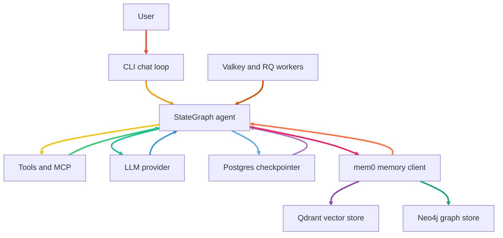

# Darwin

> An autonomous, general-purpose agentic execution engine — inspired by Claude Code and Hermes Agent.

Darwin autonomously reasons, navigates file systems, executes code in sandboxed environments, interfaces with external platforms via standard protocols (MCP), and self-corrects across complex workflows.

---

## What Darwin Does

- **Autonomous reasoning loop** — a LangGraph `StateGraph` tool-calling engine that plans first and executes second.
- **Model-agnostic** — works with any OpenAI-compatible provider (OpenAI, DeepSeek, local vLLM/Llama, Ollama) via configurable Base URL + API Key + Model Name.
- **Durable sessions** — PostgreSQL checkpointing means conversations survive process restarts.
- **Layered memory** — short-term conversational buffer, long-term vector (episodic) memory, and long-term structured knowledge graph.
- **Hybrid background work** — Redis/Valkey + RQ offloads non-blocking pipeline jobs from the reasoning loop.

## Core Features

| Feature | Stack |
|---|---|
| Reasoning engine | LangGraph StateGraph (tool-calling loop) |
| Persistence | PostgreSQL (PostgresSaver) |
| Queues | Redis/Valkey + RQ |
| Vector memory | Qdrant (via mem0) |
| Graph memory | Neo4j (via mem0) |
| Embeddings | sentence-transformers/all-MiniLM-L6-v2 (local, via mem0) |
| Validation | Pydantic structured outputs |
| Guardrails | Deterministic prompt clamp + command gating |
| Native tools | Sandboxed shell, file ops, document parser |

## MCP Shoutout

Darwin stands on the shoulders of the Model Context Protocol ecosystem:

- **@modelcontextprotocol** — filesystem, sequential-thinking, fetch, puppeteer
- **mcp-server-docker** — container lifecycles and sandboxing
- **mcp-server-git / @github/mcp-server** — local + remote Git operations
- **context7-mcp** — versioned library documentation on demand
- **firecrawl-mcp / exa-mcp-server** — neural web search and markdown scraping
- **notion-mcp / @modelcontextprotocol/server-slack** — workspace integrations
- **mcp-server-time / server-postgres / server-sqlite** — time and DB utilities

## Architecture & Flow



## Build Phases

- **Phase 1 — Core Reasoning Engine:** StateGraph, Postgres checkpointing, mem0 memory (Qdrant + Neo4j). ✅
- **Phase 2 — Native Tooling:** Sandboxed shell, file operations, document parser, Pydantic guardrails. ✅
- **Phase 3 — MCP & Routing:** MCP servers, Tool RAG, two-tier permissions.
- **Phase 4 — DevOps:** Docker/Lima sandboxing, Git/GitHub MCP.

## Getting Started

```bash
cp .env.example .env          # fill API key, model, base url + neo4j password only
docker-compose up -d          # Postgres, Qdrant, Neo4j, Valkey — pre-credentialed
uv run darwin
```

> **Resource tip:** local Neo4j needs ~1.5–2 GB RAM (JVM). Point `DARWIN_NEO4J_URI` at a free
> [Neo4j Aura](https://neo4j.com/cloud/aura/) instance instead (see `.env.example`) if you'd rather offload it.

## License

MIT — see [LICENSE](LICENSE).
