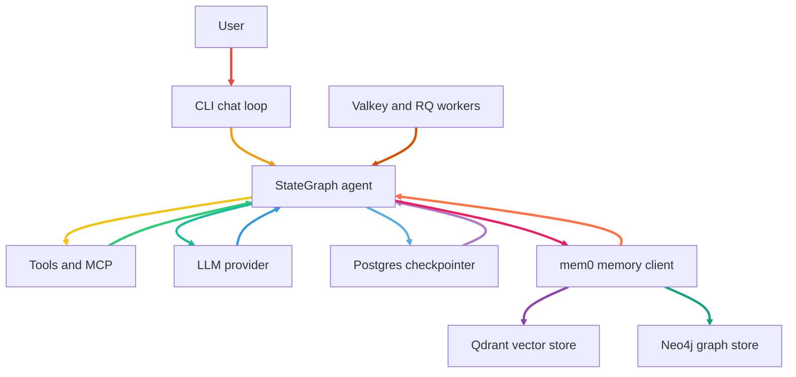

# Darwin

> An autonomous, general-purpose agentic execution engine — inspired by Claude Code and Hermes Agent.

Darwin autonomously reasons, navigates file systems, executes code in sandboxed environments, interfaces with external platforms via standard protocols (MCP), and self-corrects across complex workflows.

---

## What Darwin Does

- **Autonomous reasoning loop** — a LangGraph `StateGraph` tool-calling engine that plans first and executes second.
- **Model-agnostic** — works with any OpenAI-compatible provider (OpenAI, DeepSeek, local vLLM/Llama, Ollama) via configurable Base URL + API Key + Model Name.
- **Durable sessions** — PostgreSQL checkpointing means conversations survive process restarts.
- **Layered memory** — short-term conversational buffer, long-term vector (episodic) memory, and long-term structured knowledge graph.
- **Hybrid background work** — Redis/Valkey + RQ offloads non-blocking pipeline jobs from the reasoning loop.

## Core Features

| Feature | Stack |
|---|---|
| Reasoning engine | LangGraph StateGraph (tool-calling loop) |
| Persistence | PostgreSQL (PostgresSaver) |
| Queues | Redis/Valkey + RQ |
| Vector memory | Qdrant (via mem0) |
| Graph memory | Neo4j (via mem0) |
| Embeddings | sentence-transformers/all-MiniLM-L6-v2 (local, via mem0) |
| Validation | Pydantic structured outputs |
| Guardrails | Deterministic prompt clamp + command gating |
| Native tools | Sandboxed shell, file ops, document parser |
| CLI | rich + prompt_toolkit (boxed prompt, themes, session picker) |

## MCP Subsystem

Darwin connects to MCP servers over stdio from a single `mcp.json`, with Tool RAG masking the tool
surface per turn. Connected today:

| Server | Tools |
|---|---|
| mcp-server-time | timezone resolution, UTC sync, relative dates |
| server-sequential-thinking | dynamic thought scratchpad for multi-step planning |
| server-filesystem | scoped local file read/write |
| mcp-server-sqlite | SQLite introspection and queries |
| server-postgres | PostgreSQL query execution |
| mcp-server-fetch | HTTP fetch and HTML-to-text extraction |
| firecrawl-mcp | web search and clean markdown scraping |
| exa-mcp-server | neural web search |
| Playwright MCP | headless browser automation and visual capture |
| GitHub MCP | repository exploration, diffs, issues and pull requests |
| mcp-server-git | local repo status, diffs, log, commits, branches |
| mcp-server-docker | container lifecycles, images, networks, volumes |
| context7-mcp | versioned library documentation on demand |

All servers speak MCP over **stdio** (started from `mcp.json`); HTTP/SSE transports are not wired yet.
Tools are namespaced `server__tool`, and only the most relevant subset is bound per turn.

## Category B — Custom Tools (built in-house)

| Tool | What it does |
|---|---|
| `run_shell` | sandboxed `subprocess.run` with timeout, exit-code check, output truncation, banned-command policy, secret-scrubbed environment |
| `parse_document` | markitdown → Markdown for PDFs, Office docs and spreadsheets |
| `email_send` / `email_read` | stdlib IMAP/SMTP; outbound leak protection blocks bodies containing secrets |
| `notify_user` | desktop notification via `osascript`, no approval needed |
| `memory_recall` / `memory_save` | episodic memory via mem0 (Qdrant + Neo4j) |

Every mutating tool gates on a LangGraph `interrupt()` for human approval, with a desktop
notification so the prompt is visible even when the user isn't looking at the terminal.

## Architecture & Flow



## Repo Layout

```
src/darwin/
├── core/        # orchestrator (StateGraph), config, LLM client, mem0 memory, queues, notify
├── guardrails/  # Pydantic schemas, command policy, redaction, permissions, session scope
├── mcp/         # in-house MCP client (stdio), LangChain bridge, server check CLI
├── tools/       # shell, filesystem, documents, email, memory, notify_user
├── tui.py       # banner, boxed prompt, themes, pickers, traces
├── sessions.py  # session naming + listing from the checkpointer
└── main.py      # chat loop
```

## Build Phases

- **Phase 1 — Core Reasoning Engine:** StateGraph, Postgres checkpointing, mem0 memory (Qdrant + Neo4j). ✅
- **Phase 2 — Native Tooling:** Sandboxed shell, file operations, document parser, Pydantic guardrails. ✅
- **Phase 3 — MCP & Routing:** 13 MCP servers, Tool RAG, two-tier permissions. ✅
- **Phase 4 — DevOps:** Docker/Lima multi-runtime sandboxing, container lifecycles.

## Getting Started

Requires Python 3.11+, [uv](https://docs.astral.sh/uv/), and Docker (for the service stack).

```bash
cp .env.example .env          # set model base URL / API key; optional keys below
docker-compose up -d          # Postgres, Qdrant, Neo4j, Valkey — pre-credentialed
uv run darwin
```

> **Resource tip:** local Neo4j needs ~1.5–2 GB RAM (JVM). Point `NEO4J_URI` at a free
> [Neo4j Aura](https://neo4j.com/cloud/aura/) instance instead (see `.env.example`) if you'd rather offload it.

Optional credentials (`.env.example` documents each): `FIRECRAWL_API_KEY`, `EXA_API_KEY`,
`CONTEXT7_API_KEY`, `GITHUB_PERSONAL_ACCESS_TOKEN`, and the `EMAIL_*` block.

## CLI

Darwin opens a rich terminal UI (boxed prompt, completion, tool traces, markdown replies). Sessions are
**named from the first message** (e.g. `git-status-repo`), so they read as a conversation history.

| Command | Action |
|---|---|
| `/new` | start a fresh session |
| `/sessions` | arrow-key picker (↑/↓) to switch sessions |
| `/session` | print the sessions table |
| `/session <id>` | switch directly to a session |
| `/themes` | arrow-key theme picker (↑/↓) |
| `/theme <name>` | switch theme directly |
| `/exit` | quit |

Typing `/` opens the command menu; ↑/↓ selects, Enter completes.

The input bar is a real prompt (`prompt_toolkit`) with history and a persistent bottom toolbar showing
the commands and credits.

Themes: `tokyo-night` (default), `dracula`, `catppuccin`, `nord`, `gruvbox` — or set
`DARWIN_THEME` in `.env`. Approvals are `y/n`; out-of-workspace access uses `1/2/3` (once / session /
deny). Built by **Ayushya Saxena** · [The-Tourist-170](https://github.com/The-Tourist-170).

## License

MIT — see [LICENSE](LICENSE).
